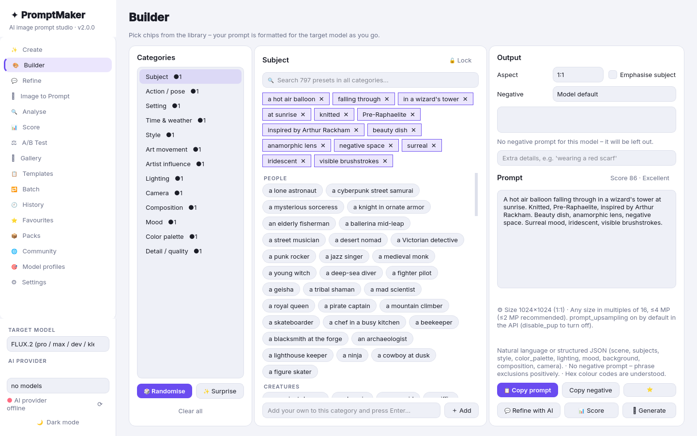

# ✦ PromptMaker

**A local desktop studio for writing AI image prompts.** You can describe an idea in plain words, build a prompt from 800 presets, refine it in a chat with a local LLM, or score it. Each prompt is formatted for the image model you're targeting, such as FLUX.2, SDXL, Pony, Illustrious, Anima, MOSS-Image, Qwen-Image, Midjourney V7, GPT Image and more.

Everything runs on your own computer by default. The AI features are optional and work with [Ollama](https://ollama.com), LM Studio, llama.cpp, KoboldCpp, vLLM or any OpenAI-compatible server, plus optional cloud providers. Version 2 can also generate images through **ComfyUI** or **Forge / AUTOMATIC1111**, and turn images back into prompts.


## Features

- **✨ Create:** type an idea like *"an anime girl wearing an outfit in a setting"* and get finished prompts for your target model. You also get a separate negative prompt (where the model supports one) and recommended settings. A creativity slider controls how much it invents, and it can give 1–5 options with live streaming. **⚡ Offline build** works without AI.
- **🎨 Builder:** 13 categories and about 800 grouped presets as clickable chips, with global search, locks, randomise/surprise and your own custom chips. A live, model-aware preview and quick score update as you go.
- **💬 Refine:** chat with a local LLM about your prompt. Apply its suggestions in one click, with full version history and revert.
- **🔍 Analyse:** paste any prompt and break it into categories (offline or with AI), then load it into the Builder.
- **📊 Score:** a rubric covering clarity, specificity, composition, style coherence and model fit. There's an instant offline heuristic with concrete fixes, plus an optional AI deep review.
- **📋 Templates** with `{subject}`-style placeholders, **🔁 Batch** variations exported to .txt/.csv, searchable **🕘 History**, and **⭐ Favourites**.
- **📦 Preset packs:** import, export, enable or disable JSON packs. 5 starter packs are included.
- **🎯 Model profiles:** an editable JSON file that controls format, negative prompts, weighting, length, parameters and resolutions for each model.
- **🖼 Image generation** *(new in 2.0)*: send any prompt to **ComfyUI** (API workflows with placeholders; SDXL and FLUX workflows included) or **Forge / AUTOMATIC1111**. It has a queue with progress and cancel, and a **Gallery** with thumbnails, full metadata, reuse prompt, same seed again and delete.
- **👁 Image to Prompt** *(new)*: drop, paste or open an image. A local vision model (Ollama vision models are detected automatically, or LM Studio / OpenAI-compatible) describes it as a prompt for your target model. Then send it to the Builder, Refine, Score or Generate.
- **⚖ A/B Test** *(new)*: compare two prompts side by side, with heuristic and AI scores and highlighted differences. With a backend connected, it renders both with the same seed. Pick a winner and it goes to History.
- **🌐 Community** *(new)*: browse, install, update and uninstall packs and model profiles from the community index. Every download is checked with SHA-256.
- **🔌 Providers** *(new)*: Ollama, LM Studio, llama.cpp, KoboldCpp, vLLM, any OpenAI-compatible URL, and optional OpenAI, Anthropic, Google Gemini and OpenRouter. All AI features stream from the provider you choose.
- **⚙ Settings, tour and languages** *(new)*: a settings page, a first-run guided tour, an optional update check, portable or AppData data, and English / Español / Deutsch (the translations are machine-made).
- A polished dark/light theme, toasts, and a **Ctrl+K** quick bar from anywhere.

## Screenshots

| Builder | Refine (chat) |
|---|---|
|  |  |
| **Score** | **Model profiles** |
|  |  |
| **Image to Prompt** | **A/B Test** |
|  |  |
| **Gallery** | **Community** |
|  |  |
| **Settings** | **Guided tour** |
|  |  |
| **Preset packs** | **Light theme** |
|  |  |

*The images in the gallery screenshots are abstract placeholders, not real model output.*

## Install

You need **Python 3.10+** ([python.org](https://www.python.org/downloads/); on Windows, tick *"Add python.exe to PATH"*).

**Windows**
1. Download or clone this repo.
2. Double-click **`install.bat`**. It checks Python, creates a `.venv`, installs PySide6, offers to make a desktop shortcut, and checks for Ollama.
3. Start the app with **`run.bat`** or the desktop shortcut.

**macOS / Linux** (should work, but is less tested)
```bash
./install.sh
./run.sh
```

There's no installer package and nothing system-wide. Everything stays in the folder, and you uninstall by deleting it.

## AI providers (optional)

Choose a provider in **⚙ Settings → AI provider**, then click **Test connection** and **Use this provider**. The model list in the sidebar comes from that provider.

| Provider | Default URL | Notes |
|---|---|---|
| Ollama | `http://localhost:11434` | `ollama pull llama3.2`. For Image to Prompt, pull a vision model such as `llava`, `qwen2.5vl` or `gemma3`. |
| LM Studio | `http://localhost:1234/v1` | Start the local server in LM Studio. |
| llama.cpp server | `http://localhost:8080/v1` | `llama-server -m model.gguf` |
| KoboldCpp | `http://localhost:5001/v1` | |
| vLLM | `http://localhost:8000/v1` | |
| OpenAI-compatible (custom) | anything | Any `/v1/chat/completions` server. |
| OpenAI · Anthropic · Google Gemini · OpenRouter | cloud | Needs an API key. **Your prompts and images are sent to that company** and may cost money. |

**API keys** are stored in your OS keyring (Windows Credential Manager, macOS Keychain or Secret Service) through the `keyring` package. If no keyring is available, they go in `data/secrets.json` as **plain text**, and the app warns you when that happens. Local providers don't need a key.

If Ollama is installed but not running, the **Create** page has a **▶ Start Ollama** button. With a local provider, nothing leaves your machine.

## Image generation (optional)

PromptMaker doesn't include an image model. It sends prompts to a backend you already run:

- **ComfyUI** (default `http://127.0.0.1:8188`). PromptMaker uses ComfyUI's API: it queues a workflow, shows progress, and saves the result. Two API-format workflows are included in `promptmaker/workflows/`: **SDXL txt2img** and **FLUX txt2img** (the FLUX one expects an all-in-one checkpoint such as `flux1-dev-fp8.safetensors`). To use your own workflow, export it from ComfyUI with *Workflow → Export (API)*, replace values with placeholders, and drop it into `data/workflows/`. The placeholders are `{{prompt}}`, `{{negative}}`, `{{width}}`, `{{height}}`, `{{seed}}`, `{{steps}}`, `{{cfg}}`, `{{checkpoint}}`, `{{sampler}}` and `{{scheduler}}`. An optional `"_meta": {"name": …, "defaults": {…}}` key sets the display name and default values.
- **Forge / AUTOMATIC1111** (default `http://127.0.0.1:7860`). Start it with `--api`. PromptMaker uses `/sdapi/v1/txt2img` and polls `/sdapi/v1/progress`.

Set the backend, URL, workflow, checkpoint, steps and CFG in **Settings → Image generation**, then use the **🖼 Generate** buttons on Create, Builder, Image to Prompt, A/B Test and Gallery. Width and height come from the target model profile's aspect ratio. Images go to `data/gallery/` as PNG files, each with a `.json` sidecar holding the prompt, negative prompt, seed, profile and settings.

## Community packs & profiles

The **🌐 Community** page reads [`community/index.json`](community/index.json) from this repository. Install, update and uninstall take one click, and each file's SHA-256 is checked before it's installed. Community packs are saved in `data/packs/`, and community profiles are merged into `data/profiles.json`. You can point the app at another index (`https://` or `file://`) in Settings. To share your own pack or profile, see [CONTRIBUTING.md](CONTRIBUTING.md#sharing-a-pack-or-profile-community-gallery).

## Model profiles

| Profile | Format | Negative prompt | Weighting | Length |
|---|---|---|---|---|
| Generic (any model) | natural | optional | none | 15–75 words |
| FLUX.2 (pro / max / dev / klein) | natural | unsupported | none | 30–200 words |
| FLUX.2 – JSON structured | json | unsupported | none | 20–300 words |
| FLUX.1 [dev / schnell / pro] | natural | unsupported | none | 30–150 words |
| FLUX.1 Kontext (image editing) | natural | unsupported | none | 8–80 words |
| Stable Diffusion XL 1.0 | tags | supported | parens | 10–75 words |
| Stable Diffusion 3.5 (Large / Medium) | natural | supported | none | 20–200 words |
| Pony Diffusion V6 XL (tags) | tags | supported | parens | 10–75 words |
| Illustrious XL / NoobAI (Danbooru tags) | tags | supported | parens | 10–75 words |
| Anima (CircleStone Labs, anime) | hybrid | supported | parens | 25–180 words |
| MOSS-Image (OpenMOSS, 5B) | natural | supported | none | 30–400 words |
| Qwen-Image (incl. 2512) | natural | limited | none | 30–250 words |
| HiDream-I1 (Full / Dev / Fast) | natural | limited | none | 20–150 words |
| Midjourney V7 | natural | param_no | mj | 10–60 words |
| OpenAI GPT Image 2 / 2.5 | natural | unsupported | none | 20–250 words |
| Google Imagen 4 (Fast / Standard / Ultra) | natural | unsupported | none | 15–200 words |

Each profile lists its sources in the app (**🎯 Model profiles**). Profiles live in `data/profiles.json`, which is created on first run. You can edit them there or in the app, or add your own. New built-in profiles are merged in automatically on update.

**Fields:** `format` natural/tags/hybrid/json · `negative` supported/optional/limited/unsupported/param_no · `weighting` parens/mj/none · `quality_prefix` · `negative_default` · `length` [min, max] · `resolutions` {aspect: "WxH"} · `settings` · `param_style` midjourney/settings/none · `ai_guidance` (sent to the LLM) · `tips` · `sources`.

## Preset packs

Packs are JSON files in `packs/`:
```json
{"name": "My pack", "description": "…", "version": "1.0",
 "categories": {"Style": {"Group name": ["item 1", "item 2"]}}}
```
Use **📦 Packs → Import / Export** to share them. Packs in `packs/` are the bundled, read-only ones. Packs you import and chips you add yourself are saved in `data/packs/` (`custom.json`). If you're upgrading from 1.x, an old `packs/custom.json` is moved there automatically.

## Keyboard shortcuts

| Keys | Action |
|---|---|
| Ctrl+K | Quick idea bar (from anywhere) |
| Ctrl+Enter | Create (Create page) / send (Refine chat) |
| Ctrl+Shift+C | Copy the Builder prompt |
| Ctrl+T | Toggle dark/light theme |

## Your data

History, templates, favourites, versions and settings are stored in `data/promptmaker.db` (SQLite). Profiles, your packs, the gallery and any plain-text key file also live in the data folder.

- **Portable mode** (the default) keeps everything in `data/` next to the app, so you can copy the whole folder anywhere.
- Turn portable mode off in **Settings** to use `%APPDATA%\PromptMaker` on Windows (`~/.local/share/PromptMaker` or `~/Library/Application Support/PromptMaker` elsewhere). Your data is copied over the first time and the change takes effect after a restart. The choice is remembered by a `use_appdata.flag` file next to the app.

The `data/` folder is git-ignored.

## Updates & privacy

When it starts, PromptMaker can ask the GitHub releases API whether a newer version exists. Nothing about you is sent, and you can switch this off in Settings. Apart from that, the app only goes online for the community index and any providers or backends you configure.

## Languages

English, Español and Deutsch. Choose one in **Settings → Language** and restart. The Spanish and German translations are **machine-translated**, and corrections are very welcome. Translations live in `promptmaker/i18n/<code>.json`, and any string without a translation falls back to English.

## Development

```bash
python -m venv .venv && .venv/bin/pip install -r requirements-dev.txt   # Windows: .venv\Scripts\pip
python -m pytest -q
python -m pyflakes promptmaker tests
QT_QPA_PLATFORM=offscreen python main.py --smoke-test   # headless UI smoke test
```

Project layout: `promptmaker/app.py` (UI), `builder.py` (prompt formatting), `scoring.py`, `providers.py` (LLM providers), `ollama.py`, `imagegen.py` (ComfyUI / A1111), `gallery.py`, `community.py`, `abtest.py`, `keystore.py`, `paths.py`, `updates.py`, `i18n.py`, `library.py` (packs), `profiles.py`, `storage.py`, `theme.py`, `widgets.py`. All network code is tested against local mock servers (`tests/test_v2.py`), so the tests don't need Ollama, ComfyUI or an internet connection.

## Contributing

Contributions are welcome, especially new preset packs and model profiles. See [CONTRIBUTING.md](CONTRIBUTING.md).

## License

[MIT](LICENSE) © 2026 Sarah Gilford
